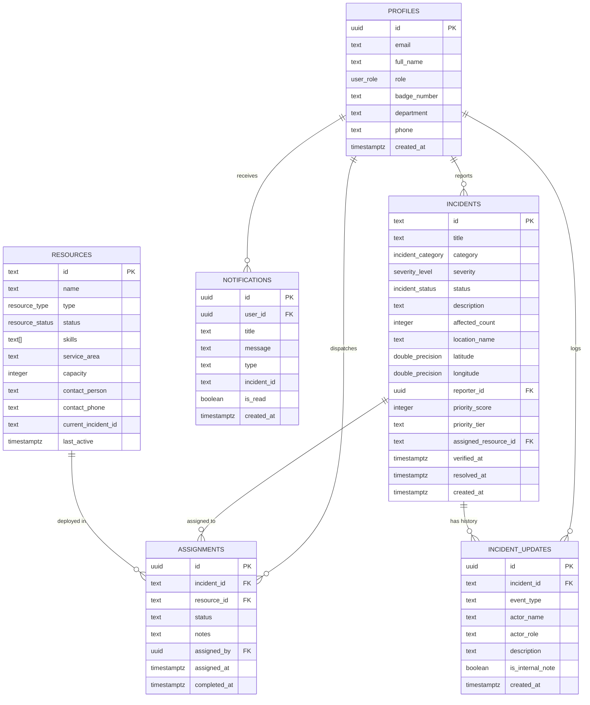

# ResQGrid — Smart Emergency Coordination Platform

> **A mission-critical community crisis triage, GIS dispatch tracking, and volunteer fleet management platform built with React 19, TypeScript, Tailwind CSS, Leaflet, and Supabase.**

[](https://www.typescriptlang.org/)
[](https://react.dev/)
[](https://vitejs.dev/)
[](https://tailwindcss.com/)
[](https://leafletjs.com/)
[](https://supabase.com/)
[](https://vitest.dev/)

---

## ⚠️ Important Safety & Simulation Disclaimer

**ResQGrid is a simulated software demonstration platform developed for portfolio and technical interview purposes.**  
It is **NOT** connected to live municipal 911, 112, or 999 emergency services and does not automatically dispatch real-world police, fire, or paramedic teams.

> **If you or someone around you is facing an immediate life-threatening emergency, please dial your local emergency services (911 / 112) immediately.** All incidents, volunteers, phone numbers, and organizations included in the demo dataset are strictly fictional simulations.

---

## 📌 Problem Statement

During natural disasters, urban infrastructure disruptions, and mass-casualty incidents, conventional emergency communication channels quickly become bottlenecked:
1. **Unstructured Reporting**: Community members report hazards across social media, leading to unverified duplicate reports and scattered coordinates.
2. **Opacity in Triage**: Responders often lack clear, transparent rationale for why certain calls are dispatched ahead of others.
3. **Resource Conflicts & Double-Booking**: Volunteer squads and municipal support teams are frequently dispatched to overlapping locations without conflict prevention or capacity tracking.
4. **Data Privacy Risks**: Public reporting portals inadvertently expose victims' and reporters' personal phone numbers and home addresses to the public.

---

## 💡 The ResQGrid Solution

**ResQGrid** bridges community reporting and authorized operational dispatching through a single, hardened command center:
- **Instant Incident Ingestion**: Mobile-responsive incident reporting with interactive Leaflet map pin dropping, automatic coordinate resolution, and Zod schema validation.
- **Rule-Based Smart Prioritization Engine**: Transparent, explainable 4-factor scoring algorithm (0–100) combining Reported Severity, People Impacted, Queue Waiting Duration, and Verification Status (with audited manual coordinator override).
- **Interactive GIS Map**: Real-time OpenStreetMap canvas displaying severity-colored pins, impact perimeter circles, dynamic filtering, and direct triage drawer popups.
- **Conflict-Safe Fleet Management**: Prevents double-booking deployed volunteers or response teams, maintains comprehensive assignment logs, and auto-releases units upon incident resolution.
- **Role-Aware Privacy & Security**: Role-Based Access Control (RBAC) protecting sensitive contact details from public inspection while providing coordinators and admins full situational awareness.
- **Offline & Zero-Config Demo Mode**: Works immediately in any browser with localStorage persistence and 9 realistic seeded emergency incidents and 6 specialized response teams. Can also be connected to a live Supabase backend.

---

## 🛠️ Technology Stack

| Layer | Technologies |
| :--- | :--- |
| **Frontend Framework** | React 19 (TypeScript) with Vite |
| **Styling & Design System** | Tailwind CSS v4, Custom CSS tokens, Dark Theme UI |
| **Geospatial & Maps** | Leaflet, React Leaflet, OpenStreetMap |
| **State & Persistence** | Unified Storage Service (Supabase Cloud + LocalStorage Fallback) |
| **Charts & Telemetry** | Recharts (Trend Area, Donut Categories, Stacked Severity Bars) |
| **Forms & Validation** | React Hook Form with Zod schemas |
| **Iconography** | Lucide React |
| **Unit & Integration Testing** | Vitest (13 tests verifying scoring, validation & conflict safety) |
| **Deployment** | Vercel (SPA rewrites configured in `vercel.json`) |

---

## 🚀 Key Features

### 1. Operations Hub Dashboard
- Real-time KPI stat cards: Open Incidents, Critical P1 Triage, Available Fleet, Average Dispatch Latency.
- Influx and resolution timeline area chart.
- Proportional donut chart of incident categories.
- Real-time live priority queue ranked by priority score.
- Chronological audit activity feed tracking state changes, verifications, and dispatches.

### 2. Incident Reporting & Map Pinning
- Full schema validation with Zod (min/max characters, positive integer constraints, coordinate boundaries).
- Interactive Leaflet pin dropping with GPS "Use My Location" detection and manual coordinate fallback.
- Live real-time priority score preview showing predicted triage classification before submission.
- Optional scene photo preview and mandatory safety acknowledgment.
- Generates unique incident ID (e.g. `RESQ-2026-1042`).

### 3. Incident Management & Drawer Workflow
- Searchable and sortable incident table with instant filtering by category, severity, and status.
- Comprehensive Incident Details Drawer:
  - Six-stage status progression: `Reported` → `Under Review` → `Verified` → `Assigned` → `In Progress` → `Resolved`.
  - Reject / Duplicate flagging with mandatory rationale.
  - Conflict-safe dispatch dropdown showing only available matching units.
  - Detailed score breakdown card showing individual factor contributions.
  - Priority Override capability with logged coordinator rationale.
  - Internal dispatcher notes section stored separately from citizen report.
  - Complete chronological timeline of all events.

### 4. Smart Prioritization Scoring Algorithm
Transparent, rule-based mathematical scoring bounded strictly between 0 and 100:
$$\text{Priority Score} = (\text{Severity} \times 0.45) + (\text{Impacted} \times 0.25) + (\text{Waiting} \times 0.20) + (\text{Verification} \times 0.10)$$

- **Severity (45% Weight)**: Critical = 100, High = 75, Medium = 45, Low = 20.
- **Impacted Persons (25% Weight)**: Stepped normalization (1 person = 25, 2–5 = 50, 6–15 = 75, 16–30 = 90, >30 = 100).
- **Waiting Duration (20% Weight)**: Measured time in queue without assignment, capped at 120 minutes = 100 score. (Resolved incidents = 0).
- **Verification Status (10% Weight)**: Verified = 100, Under Review = 65, Reported = 40 (Unverified incidents are never ignored).
- **Tier Classification**:
  - **P1** (Score ≥ 80): Critical Immediate Action
  - **P2** (Score 60–79): High Urgency
  - **P3** (Score 40–59): Elevated Priority
  - **P4** (Score < 40): Standard Queue

### 5. Fleet & Volunteer Management
- Directory of specialized units: Paramedic Teams, Hazmat Brigades, K9 Search & Rescue, First-Aid Squads, Flood Heavy Fleet, and Supply Logistics.
- Conflict prevention: Prevents assigning a resource that is actively deployed to another scene.
- One-click status toggling (`Available`, `Dispatched`, `Off Duty`, `Maintenance`).
- Add Resource enrollment modal with Zod validation.

### 6. Analytics & CSV Export
- End-to-end average dispatch latency and resolution time metrics.
- Fleet deployment ratio.
- One-click CSV export for both Incidents and Fleet records.

### 7. Instant Role Simulation for Reviewers
Reviewers can toggle personas in one click via the top bar:
- **Coordinator (Elena Rostova)**: Full triage capabilities, dispatching, priority override, private phone unmasking.
- **Administrator (Marcus Vance)**: Full platform oversight, fleet enrollment, and policy management.
- **Volunteer (Dr. Aaron Chen)**: View designated missions and update readiness.
- **Citizen Reporter**: Public reporting and status tracking with privacy masking.

---

## 📐 Database Architecture & Schema

The production schema is located at [`supabase/migrations/20260101000000_resqgrid_schema.sql`](supabase/migrations/20260101000000_resqgrid_schema.sql):



---

## 💻 Local Installation & Setup

### Prerequisites
- [Node.js](https://nodejs.org/) v18 or higher (v24 recommended)
- `npm` v9 or higher

### Step-by-Step

1. **Clone the repository**:
   ```bash
   git clone https://github.com/your-username/resqgrid.git
   cd resqgrid
   ```

2. **Install dependencies**:
   ```bash
   npm install --legacy-peer-deps
   ```

3. **Configure Environment Variables (Optional)**:
   By default, the platform boots into **Interactive Demo Sandbox Mode** with no configuration required.  
   To connect to a live Supabase database:
   ```bash
   cp .env.example .env
   ```
   Add your Supabase project credentials in `.env`:
   ```env
   VITE_SUPABASE_URL=https://your-project-id.supabase.co
   VITE_SUPABASE_ANON_KEY=your-anon-public-key
   ```

4. **Run Unit Tests**:
   ```bash
   npm test
   ```
   *Runs 13 Vitest tests verifying the scoring engine, Zod validation, and conflict-safe assignments.*

5. **Start Development Server**:
   ```bash
   npm run dev
   ```
   Open [http://localhost:5173](http://localhost:5173) in your browser.

6. **Build for Production**:
   ```bash
   npm run build
   ```

---

## ☁️ Deployment Instructions (Vercel)

1. Push your repository to GitHub.
2. Log in to [Vercel](https://vercel.com) and click **Add New Project**.
3. Import your `resqgrid` repository.
4. Framework Preset: **Vite** (auto-detected).
5. Build Command: `npm run build`
6. Output Directory: `dist`
7. (Optional) Add your `VITE_SUPABASE_URL` and `VITE_SUPABASE_ANON_KEY` under Environment Variables.
8. Click **Deploy**. Vercel will build and serve your app globally.

---

## 🎯 Internship & Interview Talking Points

When presenting ResQGrid to engineering managers and interviewers, focus on these architecture and design decisions:

1. **Why rule-based prioritization instead of black-box AI?**
   > *"In life-safety coordination, predictability, transparency, and auditability are non-negotiable. If a coordinator asks why a 3-alarm warehouse fire ranks above an overturned vehicle, our algorithm provides exact numerical weight breakdowns: Severity (45%), Affected (25%), Waiting (20%), and Verification (10%). Coordinators can also manually override the score while logging a mandatory audit rationale."*

2. **How did you prevent resource conflicts and race conditions?**
   > *"I engineered a conflict-safe dispatch layer within the unified storage service. Before dispatching a team, the engine verifies their current assignment state. If a unit is already active at another scene, dispatch is blocked with a clear warning. When an incident is marked Resolved, the engine automatically frees the unit and logs the completed mission in their assignment history."*

3. **How does privacy work across different roles?**
   > *"We implemented strict role-based data masking. A citizen reporter or unauthenticated observer only sees masked contacts (e.g. `555-***-4491`), whereas authorized Coordinators and Administrators see unmasked callback phone numbers. On the database level, this is backed by Supabase Row Level Security (RLS) policies."*

4. **Zero-Config Demo Architecture**:
   > *"To make this portfolio piece friction-free for technical recruiters, I built a dual-mode persistence architecture. If Supabase environment keys are absent, the application gracefully initializes a complete in-memory and localStorage sandbox with 9 realistic seeded incidents and 6 units. Recruiters can test every feature without creating an account or configuring a database."*

---

## 📄 License

Distributed under the MIT License. Developed for software engineering demonstration and technical portfolio showcase.
